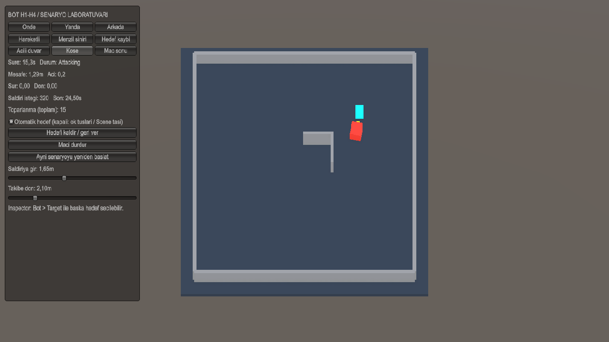

# H1–H4 doğrulama — 11 Kasım 2026

Unity 6000.4.4f1, açık Editor üzerinde son kod ve kaydedilmiş
`Assets/Scenes/Tests/AI/BotScenarios.unity` ile çalıştırıldı. Derleme hatası: 0.
Son Console ground-truth örneğinde hata ve uyarı: 0.

## Otomatik fizik senaryoları

`BotScenarioChecks.RunInPlayMode()` sonucu:

```text
Front: PASS
Side: PASS
Behind: PASS
Range hysteresis, attack gates, target loss/restore: PASS
Corner escape x3, stop and restart: PASS
Angled wall: PASS
Range tuning 1.50/2.00m follow + corner: PASS
Moving target 540 simulated seconds: PASS
  maximum distance: 4.38m
  longest non-attack stall: 0.52s
  attack requests: 8636
```

Ham çıktı: [H1-H4-results.json](H1-H4-results.json).

Hedef kaybı testleri null atama, devre dışı hedef, silinmiş hedef ve yeniden
atamayı kapsar. Menzil bandı 300 fizik adımı boyunca oynatılır; giriş ve çıkış
mesafeleri arasında ileri komutunun sıfır kalması, menzil dışındayken istek
üretilmemesi kontrol edilir. Yan ve arka hedef saldırı üretmez. Köşe üç kez aynı
konumdan denenir; aktif toparlanma sırasında maç kapısı kapatılır ve yeniden
açıldığında eski manevra durumunun kalmadığı doğrulanır.

540 saniye, üç adet 180 saniyelik örnek maç süresine karşılık gelen **hızlandırılmış
Unity fizik simülasyonudur**. Gerçek zamanlı 9 dakika izlendiği iddia edilmez.
Bu koşu aynı sinüs rotasını kullanır; keyfi hareketler veya bütün arena
geometrileri için garanti değildir.

## Normal Play modu gözlemi

Son testten sonra Köşe seçildi ve bot normal FixedUpdate döngüsünde çalıştırıldı.
9317. karede senaryo süresi 14.56s, mesafe 1.29m, durum `Attacking`, komut
`(0, 0)` ve istek sayısı 284 idi. Bot L engelini dolaşıp hedefe döndü.
Görüntüdeki toparlanma sayısı önceki otomatik denemeleri de içeren oturum toplamıdır.



## Arena ve mevcut özelliklerin regresyonu

- `RobotDamageChecks.RunInPlayMode()`: **30 kontrol PASS**. İki ithal robotta
  parça ayrılması, aşınma, fizik enkazı, hareket katsayıları, silah kaybı,
  sağlık sıfırlama, geçersiz hasar ve yenilgi kontrolleri geçti.
- Arena normal Play modunda ilerledi: yeniden başlatma karesi 1346, sonraki
  örnek 7184. Oyuncu girişi olmadan robot teması ve hasar üretildi.
- Hedefin yenilgi olayıyla maç kapanınca bot `Idle`, `MatchRunning=false`,
  bot ve motor komutları `(0,0)`, saldırı isteği `false`, maç sonucu `true` idi.
- `ArenaMatchController.RestartMatch()` sonrasında iki can 100, bot `Idle`,
  `MatchRunning=true`, komut `(0,0)` idi; sonraki fizik adımı normal takipten başlar.
- `MatchRegression.RunFresh()`: **B1–B3 ve B4 bildirim senaryoları PASS**.
  Yalnız bildirim modu, geçersiz/tekrar bildirimler, iki aynı değerlendirme
  sırası ve yeniden başlatma korundu. Bu testin mevcut **Emin beraberlik politikası
  bekleniyor** notu bu işin dışındadır.
- `git diff --check`: hata yok.

## Gözlem sırasında giderilenler

- Fizik deneme sürücüsündeki `SendMessage("FixedUpdate")` aynı nesnenin botunu
  da tekrar güncelliyordu. Motorun açık `Step(dt)` girişi kullanıldı; her fizik
  adımında tam bir karar ve bir motor adımı çalışır.
- Kısa geri dönüşün ardından doğrudan hedefe dönmek aynı köşeye tekrar girişe
  yol açabiliyordu. Geri çıkıştan sonra sabit süreli dönüş ve kısa kaçış sürüşü
  uygulanır; ardından takip yeniden değerlendirilir.
- Arena temasında hedef, saldırı sınırının hemen dışına itilebiliyordu. Durma
  payı ile bot menzilin biraz içine yaklaşır; Arena ölçülerine uygun menzil
  değerleri prototip adaptöründe seçildi. Sınır dışına saldırı isteği verilmez.

Tekrar adımları, ayarlar ve dövüş/maç bağlantı örnekleri:
[H1-H4-PR.md](H1-H4-PR.md).
