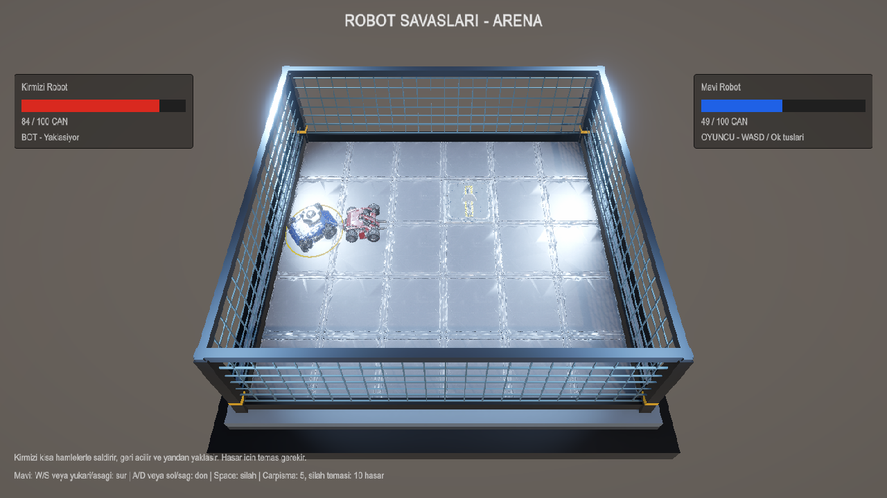

# Arena botu: saldırı ritmi ve spin döngüsünden çıkış

11 Kasım 2026, Unity 6000.4.4f1.

Önceki bot sürekli hedefin konumuna dönüyordu. Takılma kontrolü sadece ileri
sürüşte konum ilerlemesini izlediği için yerinde dönüş veya birbirinin etrafında
dolaşma durumunu yakalamıyordu. Menzile girince sınırsız saldırı isteği de
oyuncuya düzenli karşı hamle aralığı bırakmıyordu.

Arena'nın `RobotPrototypeController.ConfigureCombat` adaptörü artık oluşturduğu
botta `enableCombatTactics=true` ayarlar. Oyuncu motorunun hızı ve dövüş hasarı
değişmez. Yeni bot:

- Takipte motorun %62 ileri komutunu kullanır; dönüş komutu en fazla %70'tir.
  Hedef yönünü 0,16 saniyede bir günceller. Saldırı menzili/ön açı kontrolü her
  fizik adımında güncel gerçek hedef konumuyla yapılır.
- İlk uygun saldırıdan sonra en fazla 1,05 saniyelik baskı uygular; sonra
  geri açılır, yanda bir konum dener ve yeni hamleden önce 0,55 saniye bekler.
- Yakın hedef 100°/s üstünde 0,85 saniye boyunca dönerse manevra değiştirir.
  Mesafeyi en az 0,25m azaltamayan 2,4 saniyelik yakın takibi de keser.
  Robot sağlığı varsa 2,9 saniyelik hasarsız yakın karşılaşma da aynı çıkışı tetikler.
- Geri açılma 0,65s, yan konum denemesi 1,25s sürer. Bu aşamalarda saldırı
  isteği göndermez. Manevra hedefleri başlangıçta dünya koordinatlarında
  sabitlenir; rakibin dönmesiyle her kare yeniden dönmez. Yan tercih sırayla
  değişir; sınırın hedefin üstüne sıkıştırdığı taraf yerine diğer taraf seçilir.
- Ara hedefleri Arena'nın güvenli merkez sınırları X=±4,25, Z=±3,25 içine alır.
  Başka arena ölçülerinde `tacticalHalfExtents` ayarlanmalıdır.
- Hedef kaybı, yenilgi, maç durdurma ve yeniden başlatma bütün taktik sürelerini
  temizler. Önceki H3 duvar toparlanması önceliğini korur.

Arena'daki kırmızı panel, `Geri aciliyor`, `Yan pozisyon aliyor`, `Hamle arasi
bekliyor` gibi anlık durumu gösterir. Bu ayarlar Play modunda kırmızı robotun
`RobotBotController` bileşenindeki Combat rhythm bölümünde incelenebilir.

Normal Play modu görüntüsü:



## Tekrarlanabilir kontroller

Arena Play modundayken **Robot Savaslari > Bot > Run Arena Tactics Checks
(Play Mode)** veya aşağıdaki C# girişini kullan:

```csharp
RobotSavaslari.Editor.BotTacticsChecks.RunInPlayMode();
```

Bu test Arena'daki gerçek robot collider'larını ve iki ortak motoru 0,02s
fizik adımlarıyla sürer. Hasarı geçici olarak durdurarak saldırı niyetinin
ritmini ve hasarsız spin durumunu ayrı ölçer. Sonunda normal maçı yeniden başlatır.

| 30 simülasyon saniyesi | Yerinde spin | İleri sürerek daire |
| --- | ---: | ---: |
| Pozisyon değiştirme | 8 | 8 |
| En uzun kesintisiz yerinde dönüş | 0,30s | 0,46s |
| En uzun kesintisiz saldırı isteği | 0,34s | 0,40s |
| Saldırı isteği olan fizik adımı | 189/1500 | 165/1500 |

İki senaryoda da geri açılma, yan konum ve bekleme görüldü. Hareketsiz hedefe
saldırı, üç taktik aşamasının her birinde durdurma, temiz yeniden başlatma ve
hedef kaybı da PASS. Ham çıktı: [Tactics-results.json](Tactics-results.json).

Gerçek temas hasarı için ayrı giriş:

```csharp
RobotSavaslari.Editor.BotTacticsChecks.RunCombatInPlayMode();
```

Bu test gerçek `DealContactDamage`, robot parçaları ve maç sonu akışını kullanır.
Oyuncu motoruna kontrollü girdi, silahına Space karşılığı istek verilir.
Hızlandırılmış fizik döngüsü `Time.time` ilerletmediğinden test sürücüsü
yalnız bu koşu boyunca mevcut özel temas cooldown sürelerini adım başına 0,02s
azaltarak kalan beklemeyi ilerletir. Hasar miktarı veya runtime cooldown kodu
değişmez. Bu nedenle sonuçlar insan oynanışının gerçek zamanlı kaydı değildir.

| Kontrollü karşılaşma (en fazla 60s simülasyon) | Bot canı | Oyuncu canı | Sonuç |
| --- | ---: | ---: | --- |
| Hareketsiz, silahsız oyuncu | 78,8 | 0 | Bot hasar verip maçı bitirdi |
| Silah açık, ileri sürerek spin | 0 | 24,8 | Oyuncu karşılık verip kazandı |

İki karşılaşmada da bot dört kez pozisyon değiştirdi. Bunlar belirli iki
kontrollü girdinin sonuçlarıdır; bütün oyuncular için kazanma oranı garantisi
veya geniş çaplı zorluk dengelemesi değildir.
Ham çıktı: [Tactics-combat-results.json](Tactics-combat-results.json).

## Regresyon

- Son kod derlemesi: 0 hata, 0 uyarı.
- H1–H4 laboratuvarı: ön/yan/arka takip, menzil, hedef kaybı, üç köşe tekrarı,
  açılı duvar, ayar değişikliği ve 540 simülasyon saniyelik takip tekrar PASS.
- Mevcut `RobotDamageChecks`: 30 kontrol PASS.
- Mevcut Burak B1–B4 maç regresyonunun sonucu ayrıca doğrulandı; beraberlik
  politikası hakkında önceki bekleyen ekip kararı bu değişikliğin kapsamı dışındadır.

Yeni taktik katmanı, saf motor kabul senaryolarını korumak için
`BotScenarios.unity` içinde varsayılan olarak kapalıdır. Yeni davranış doğrudan
`Arena.unity` Play modunda denenmelidir. Genel yol bulma hâlâ yoktur; kapalı
labirent veya farklı arena geometrileri ek engel algısı gerektirir.
