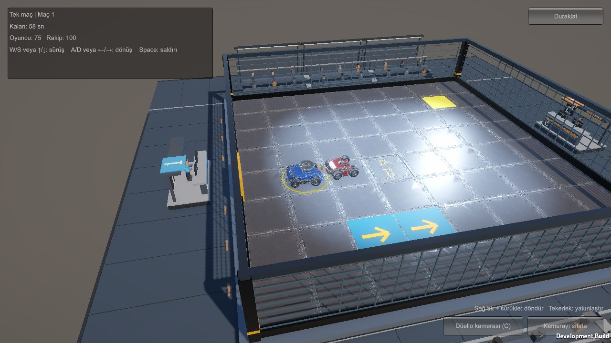

# MainArena tribünleri ve pilot ekipleri

24 Kasım 2026. Başlangıç revizyonu `a1754a26547b4b0fa6e933500c8032ee8bf12334`. Atmosfer güncellemesi hazır Döner ve Kama seçimi bulunan birleşik `test` dalında çalışır. Unity proje kökü `RobotArena`, giriş sahnesi `Assets/Scenes/Gameplay/MainArena.unity`.

## Görsel içerik ve maliyet

İki tribünün üçer bölümü vardır. Ön sırada kolları ve ayakları ayrı modellenmiş figürler, arka sıralarda daha sade oturan seyirciler bulunur. Altı grup farklı fazlarda hareket eder. Numaraları geometriden oluşan iki kabin, pilotları ve ekranları sahanın kısa uçlarında durur. Mavi 1 kabini oyuncu doğma noktasına yakın uca yerleşir. Turuncu 2 karşı uçtadır. Takım şeritleri, soğuk beyaz kabin ışıkları ve üç küçük amber hakem lambası saha dışındadır.

Geometri ve sesler bu teslim için kodla üretilmiştir. URP/Lit kullanan bütün dekor tek bir 16 × 1 renk paletini paylaşır. Kutu, konik gövde ve altı yüzlü başlar Unity mesh'lerine bir kez yazılır. Normal kalitede her karede altı seyirci grubu ve iki pilot grubunun dönüşümleri güncellenir. Lamba şiddeti değişince renderer'ın materyal özellikleri güncellenir. Düşük kalitede ikinci sıra son sıradır, pilot yardımcıları kaldırılır ve sabit figürler çelik konstrüksiyonun mesh'iyle birleştirilir. İki kalitede de dekor gölge çizmez. Kafesin dışındaki alçak kamera ile duvarın iç kenarı arasına girebilecek tribün veya kabin, o görüş açısı için gizlenir.

| Kalite | Render grubu | Üçgen | Hareketli figür grubu |
|---|---:|---:|---:|
| Normal | 15 | 10.068 | 8 |
| Düşük | 7 | 4.812 | 0 |

## Üretim sahnesi ve regresyon

Unity `6000.4.4f1 (360f97ecca93)`, AMD Ryzen 9 9950X3D2, NVIDIA GeForce RTX 5090. Kaynak kontrolleri `78655e8` (model), `31dde46` (maç ve ses), `341e088` (kontroller), `7dcb27d` (sahne kapanışı) ve `3d90dbf` (son çeper zemini, ekip numaraları ve ışık rayları) ile izlenebilir.

| Kontrol | Sonuç |
|---|---|
| Tüm EditMode testleri | 226/226 geçti, 0 atlandı. [EditMode sonucu](evidence/arena-venue-20261124/edit.xml) |
| Atmosfer, hazır robot ve düello PlayMode testleri | 11/11 geçti. Open, Tactical, PulseArena ve SweepArena aynı iki robot, aynı oyun collider'ları ve tek atmosfer kökünü korudu. Ayarlar ve maç sonu incelemesi sunumu durdurdu. [PlayMode sonucu](evidence/arena-venue-20261124/play.xml) |
| Kalite ve kamera | İki kalitede de tüm render sınırları oyun alanının dışında kaldı. Aynı düzen/kalite tekrar uygulandığında aynı mesh kullanıldı. Alçak kamera engel oluşturabilecek tribünü gizledi, yüksek bakışa dönünce geri getirdi. |
| Normal Windows x64 derlemesi | Üretim paketi 500.964.594 bayt. `RobotSavaslari.Gameplay.dll` SHA-256 `50c6c05d045ad5161d9997f251d710d09083dbefc4a5f86700713626a70906b0`. |
| Normal oyunda klavye kabulü | 2/2 maç. Enter ile geri sayım, gerçek sürüş ve iki yönlü hasar, bölgesel aşınma, tek sonuç ve R ile rövanş geçti. İki maçta da ikişer parça koptu. [Build ve oyuncu günlüğü](evidence/arena-venue-20261124/release-acceptance.txt) |
| Kullanıcı kayıtları | Son beş koşunun her birinde 46 registry girdisi, 6 kişisel dosya ve 1 tekrar için Save, Restore ve Verify geçti. [İçeriksiz doğrulama özeti](evidence/arena-venue-20261124/preferences-verification.json) |

İlk PlayMode koşusunda sahne kapanışında silinmiş bir ses kaynağına erişim iki testi bozdu. Kapanışta kaynak ve görsel kök kontrolü eklendi. Yukarıdaki 11 test düzeltmeden sonra çalıştırıldı.

İlk normal Windows paketinin kabul turu, ilk maçta iki robotun da gerçek temas hasarı alması koşulunda durdu. Birleşmiş `test` tabanındaki on deney maçından biri de bu koşulda durmuştu. Son normal paket aynı klavye sürücüsü ve aynı kabul koşullarıyla yeni bir oturumda iki maçı geçti.

## Windows ölçüm yöntemi

Aynı Open hazır düellosu ve aynı yörünge kamerası kullanılır. Takip uzaklığı 16 m, eğim 37°, yatay açı 12° olarak sabitlenir. VSync kapanır ve kare sınırı kaldırılır. Oyuncu hareket komutu vermeden hazır bot normal girişten maça başlar. 45 kare ısınmadan sonra 300 ardışık kare kaydedilir. 720p'de önce atmosfer kapalı, 1080p'de önce açık koşulur. Her koşul sahneyi baştan yükler.

CPU ve GPU süreleri Unity FrameTimingManager'dan gelir. Fizik süresi `Physics.Simulate`, yönetilen tahsis `GC Allocated In Frame`, toplam tahsis ise `Profiler.GetTotalAllocatedMemoryLong` üzerinden kaydedilir. Bu sayılar aynı karede çalışan oyun ve test oynatıcısını kapsar. P95, sıralı 300 örneğin 285'incisidir. Kaynak CSV kare başına değerleri içerir.

| Çözünürlük | Atmosfer | CPU p95 (ms) | GPU p95 (ms) | Fizik p95 (ms) | GC p95 (B/kare) | Toplam bellek medyanı (MiB) |
|---|---|---:|---:|---:|---:|---:|
| 1280 × 720 | Kapalı | 2,1144 | 1,9338 | 0,1082 | 7.292 | 233,64 |
| 1280 × 720 | Açık | 2,0550 | 1,9223 | 0,0880 | 7.292 | 235,26 |
| 1920 × 1080 | Kapalı | 2,2744 | 2,1629 | 0,1156 | 7.292 | 235,52 |
| 1920 × 1080 | Açık | 2,2788 | 2,1138 | 0,0943 | 7.292 | 236,35 |

Her koşulda üç süre, GC ve bellek sayaçları 300 örnek verdi. Bu açık/kapalı koşusunda bellek medyanı 720p'de 1,62 MiB, 1080p'de 0,83 MiB yükseldi. CPU/GPU p95 farkının mutlak değeri dört karşılaştırmada da 0,06 ms'nin altında kaldı. Her çözünürlükte bir eşleştirilmiş örneklem alındı. [1.200 karenin ham verisi](evidence/arena-venue-20261124/frames.csv) · [Windows oyuncusunda NUnit sonucu](evidence/arena-venue-20261124/windows.xml)

## Maç görüntüleri



İlk çekimde yakın takip kamerası robotu dolduruyordu. Dış çeper için oyuncunun kullanabildiği geniş takip ayarı seçildi. Bu açıdan yakın kabinin zemin bağlantısı ve numarası zayıf görünüyordu. Son sürümde tüm tesisler çelik servis zeminine oturur, iki takım numarası kabin tavanında da görünür. Görüntüler Windows test oyuncusundaki gerçek geri sayım, maç, bot silah isabeti ve sonuç anlarından gelir. Paylaşım kopyaları tam çözünürlüklü JPEG, yerel PNG asılları `RobotArena/Logs/PveEvidence/venue-windows-final-artifacts/` altındadır.

| Görüntü | 1280 × 720 | 1920 × 1080 |
|---|---|---|
| Kapalı, geri sayım | [720p](evidence/arena-venue-20261124/720-off-countdown.jpg) | [1080p](evidence/arena-venue-20261124/1080-off-countdown.jpg) |
| Açık, geri sayım | [720p](evidence/arena-venue-20261124/720-on-countdown.jpg) | [1080p](evidence/arena-venue-20261124/1080-on-countdown.jpg) |
| Kapalı, maç | [720p](evidence/arena-venue-20261124/720-off-playing.jpg) | [1080p](evidence/arena-venue-20261124/1080-off-playing.jpg) |
| Açık, maç | [720p](evidence/arena-venue-20261124/720-on-playing.jpg) | [1080p](evidence/arena-venue-20261124/1080-on-playing.jpg) |
| Açık, bot isabeti | [720p](evidence/arena-venue-20261124/720-on-hit.jpg) | [1080p](evidence/arena-venue-20261124/1080-on-hit.jpg) |
| Açık, sonuç | [720p](evidence/arena-venue-20261124/720-on-result.jpg) | [1080p](evidence/arena-venue-20261124/1080-on-result.jpg) |

## Yeniden çalıştırma

Çalışma alanında `PvE/atmosphere` dizininden aşağıdaki PowerShell komutları kullanıldı. Koşu etiketleri her yeni çalıştırmada farklı olmalıdır. Grafik ölçümleri D3D12 (feature level 12.2) Windows test oyuncusunda yapıldı. Unity düzenleyicisi ve toplu moddaki normal oyun kabulü D3D11'i kullandı. Windows testi `ArenaVenueWindowsTests.CompareOpenAt720And1080`, ortam ölçümü dizinini `ARENA_VENUE_EVIDENCE` değişkeninden alır. [Oyuncunun aygıt günlüğü](evidence/arena-venue-20261124/player-device.txt)

```powershell
& ../Run-PveUnity.ps1 -Task atmosphere -Mode EditMode -Label venue-edit-final
& ../Run-VenueWindows.ps1 -Label venue-windows-final
& ../Run-PveUnity.ps1 -Task atmosphere -Mode PlayMode -Label venue-play-final -Filter 'ArenaVenueTests;KamaPlayModeTests;DuelSetupTests'
& ../Run-PveUnity.ps1 -Task atmosphere -Mode Build -Label venue-build-final
& ../Run-PveUnity.ps1 -Task atmosphere -Mode Acceptance -Label venue-smoke-final
```

Bağımsız bir depo kopyasında Unity Test Runner, `ArenaVenueTests` için PlayMode'u ve `ArenaVenueWindowsTests` için “Run all in player / StandaloneWindows64” hedefini kullanır. İkinci fikstür görüntüleri kendi geçici dizinine veya belirtilen kanıt dizinine yazar. Normal oyun derlemesi depodaki `RobotSavaslari.Editor.BuildWindowsPlayer.Build` metodundan oluşturulur. Yerel çalışma alanındaki komutlar aynı işlemleri tek oturumda yürütüp kullanıcı kayıtlarını saklar ve geri yükler.

Unity düzenleyicisiyle ilk bağımsız Windows test oyuncusu arasındaki bağlantı, sonuç dönmeden kesildi. Son çalıştırmada oyuncunun kendi NUnit sonucu da yazıldı. İlk oturumun kişisel kayıtları sonraki Windows oturumunun başlangıç kopyasıyla karşılaştırıldı. Registry girdilerinde ve kişisel dosyalarda değişiklik bulunmadı, tekrar hash'leri eşleşti.
